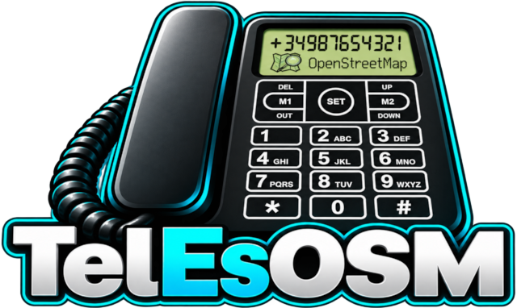

  
  
Validación de teléfonos y análisis de formatos en OpenStreetMap para España.

  
<a href="https://atarom.github.io/TelEsOSM/"><strong>Abrir la aplicación</strong></a>

---

**TelEsOSM** permite revisar las etiquetas telefónicas de [OpenStreetMap](https://www.openstreetmap.org/) por comunidad autónoma o en toda España. Identifica problemas en los números, detecta duplicados y distingue numeración fija, móvil y especial.

La vista **Validación** agrupa las incidencias y localiza los elementos en el mapa, con enlaces a OSM, iD, JOSM y Rapid. La vista **Formatos** muestra un ranking de cómo se escriben los teléfonos, con cantidades y porcentajes: al seleccionar un formato.

### Tecnologías y datos

Consultas a [Postpass](https://postpass.geofabrik.de/) como motor predeterminado, con [Overpass API](https://wiki.openstreetmap.org/wiki/Overpass_API) como alternativa. Mapa con [OpenLayers](https://openlayers.org/) y validación telefónica mediante [libphonenumber-js](https://github.com/catamphetamine/libphonenumber-js). Datos y mapa base de [OpenStreetMap](https://www.openstreetmap.org/copyright).

